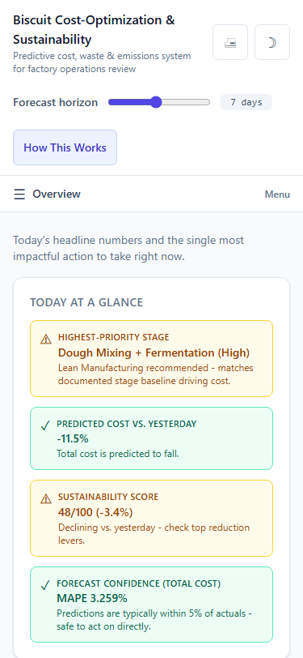
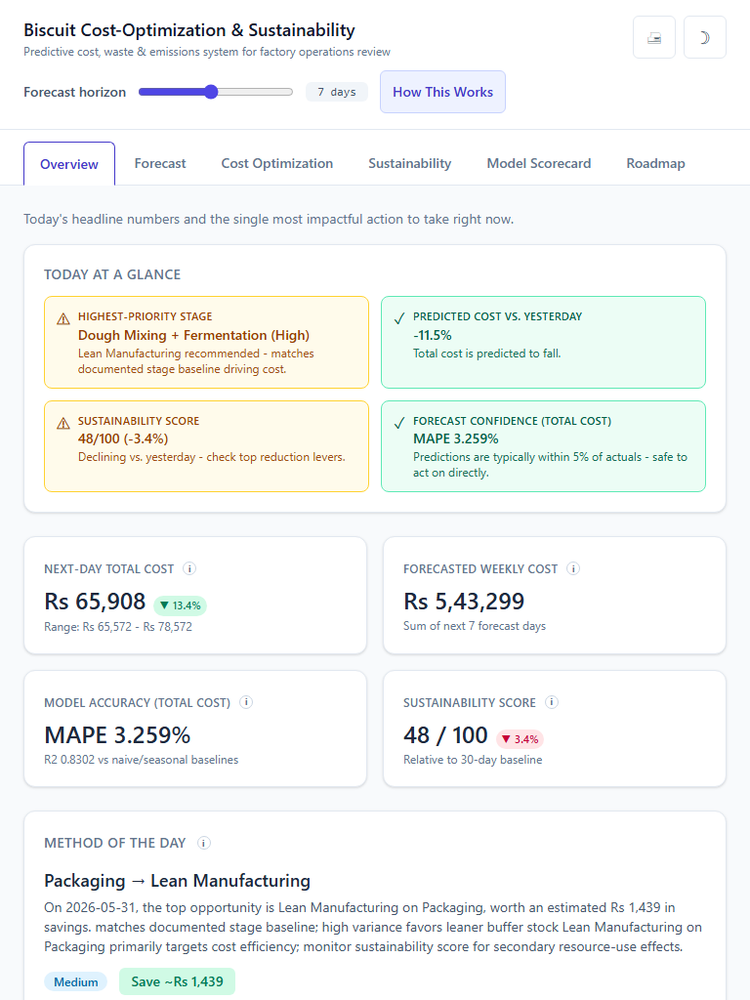
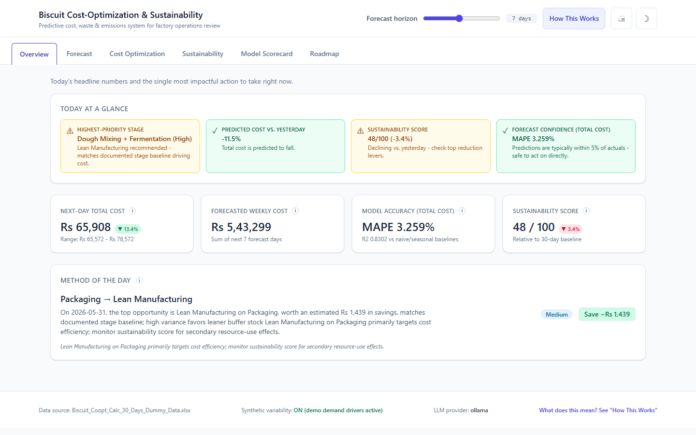
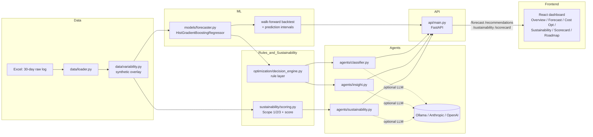

# Biscuit Manufacturing: Predictive Cost-Optimization & Sustainability System

**A full-stack ML dashboard that forecasts biscuit-factory cost, waste, and emissions 7-14 days out, then converts those forecasts into a prioritized, rule-driven action plan for plant managers** — built end-to-end with a scikit-learn forecasting pipeline, a deterministic rule engine, optional LLM-written executive narratives (with automatic rule-based fallback), and a responsive, accessible React dashboard with light/dark modes, mobile card layouts, and a shift-handoff print summary.

**Live demo:** _deploy the backend (Render/Railway) and frontend (Vercel/Netlify) following [DEPLOYMENT.md](DEPLOYMENT.md), then replace this line with your live URL._

| Mobile (375px) | Tablet (768px) | Desktop (1440px) |
|---|---|---|
|  |  |  |

A demo system that takes 30 days of biscuit-factory operational data and:

1. **Forecasts** raw-material demand, cost per stage, energy use, waste and water for the next N days using classical ML (scikit-learn gradient-boosted trees), with honest accuracy metrics and prediction intervals.
2. **Classifies** each production stage into the best cost-optimization method (Lean Manufacturing, JIT, Six Sigma, Predictive Maintenance, Energy Optimization, Kaizen, Supplier/Recipe Optimization) via a deterministic rule layer, with an LLM writing the executive rationale.
3. **Scores sustainability** - Scope 1/2/3 emissions, non-renewable resource use, waste and water intensity, rolled into a single sustainability score.
4. **Explains** everything in plain executive language via Pydantic-AI agents (Ollama by default, swappable to Claude/OpenAI, or `none` for zero-LLM deployments).
5. **Synthesizes a Roadmap** - a ranked, ready-to-act list of interventions (quick wins vs. strategic investments) built purely from the forecast + rule-engine outputs already produced by the other tabs.
6. Presents it all in a responsive, accessible React/TypeScript dashboard usable on a factory-floor tablet as comfortably as a desktop.

## Tech Stack

| Layer | Technology |
|---|---|
| Forecasting | Python, pandas, scikit-learn (`HistGradientBoostingRegressor`, quantile loss for prediction intervals) |
| Rule engine | Deterministic Python rules (`optimization/rules.py`) - always runs before any LLM call |
| LLM agents | Pydantic-AI, provider-agnostic (Ollama / Anthropic / OpenAI / none), always with a templated rule-based fallback |
| API | FastAPI, single-flight in-memory caching, background cache warm-up on startup |
| Frontend | React 19, TypeScript, Vite, Tailwind CSS v4 (custom design tokens, class-based dark mode), Recharts |
| Testing | pytest (backend), Playwright (`smoke.mjs`, `responsive-smoke.mjs`) |
| Tooling | Lighthouse (accessibility/performance audits), oxlint |

## Architecture



```
data/           raw Excel loader, tidy long/daily aggregation, synthetic variability overlay
sustainability/ Scope 1/2/3 emissions engine, sustainability scoring
models/         feature engineering + classical ML forecaster (never the LLM)
optimization/   deterministic rule layer + per-day decision engine ("Method of the Day")
agents/         Pydantic-AI agents (classifier, sustainability advisor, insight writer) - reason over ML/rule outputs only, with rule-based fallback if the LLM is unreachable
api/            FastAPI backend wiring it all together
frontend/       React + Vite + TypeScript + Recharts + Tailwind dashboard
reports/        generated model_scorecard.json / .md
screenshots/    Overview tab at mobile/tablet/desktop widths (used above)
tests/          pytest: schema, forecaster metrics, agent fallback
```

Data flow: `Excel -> data/loader.py -> data/variability.py -> models/forecaster.py -> optimization/decision_engine.py -> agents/* -> api/main.py -> frontend`.

## ⚠️ Honest data note (read this first)

The 30-day source workbook (`data/Biscuit_Coopt_Calc_30_Days_Dummy_Data.xlsx`) is **near-deterministic**: daily total cost has a standard deviation of ~₹0 across all 30 days. A naive forecaster on the raw data would score ~99% "accuracy" and mean nothing.

We handle this with `SYNTHETIC_VARIABILITY` (default `True`, see `config.py` / `.env`):

- **When `True`** (default): `data/variability.py` overlays documented, seeded demand drivers - weekly seasonality (lower weekend output), a mild monthly trend, commodity price drift on gas/electricity/packaging/dough, and Gaussian noise - making forecasting a genuine learning task. Every driver added is listed in that module's docstring.
- **When `False`**: the system runs on raw data and the dashboard footer / model scorecard show an explicit banner: *"Source data is near-constant; forecast is trivial. Enable SYNTHETIC_VARIABILITY for a representative demonstration."*

The dashboard footer, the in-app "How This Works" panel, and `reports/model_scorecard.md` always disclose which mode is active. This is a demo overlay on top of a real pipeline, not a substitute for real operational history - swap in real daily logs and it runs unmodified.

## Data validation (reproducing the executive workbook)

`python -m data.loader` prints a validation summary and reproduces `Biscuit_Executive_Cost_Optimization_Formatted.xlsx` directly from the 30-day raw log (stage costs, contribution %, savings estimates) - confirming the two source files are consistent to within rounding (max abs diff ₹0 in our run).

## Emissions & sustainability

The raw log's `Scope 1/2/3 (kgCo2e)` columns ship empty. `sustainability/emissions.py` computes them from activity data using documented, demo-grade emission factors (India grid ~0.79 kgCO2e/kWh, gas combustion ~2.0 kgCO2e/m3, packaging ~1.5 kgCO2e/kg, dough ingredients ~0.6 kgCO2e/kg - all labeled assumptions, not a certified inventory). `sustainability/scoring.py` rolls emissions intensity, non-renewable resource share, waste intensity and water intensity into a single 0-100 score, using relative-deviation-from-baseline normalization (not min-max) so the near-flat source data doesn't produce misleadingly dramatic score swings.

## Cost-optimization method glossary

| Method | When the rule layer recommends it |
|---|---|
| Lean Manufacturing | Documented stage baseline (Dough Mixing, Packaging) or high forecast uncertainty favoring leaner buffers |
| JIT | High forecast uncertainty / demand variance |
| Six Sigma | High reject/waste share for a stage (Moulding) |
| Predictive Maintenance (TPM) | High energy cost share, often paired with Energy Optimization |
| Energy Optimization | Stage cost dominated by gas/electricity (Baking, Cooling) |
| Kaizen | Large cost-contribution stage with no single dominant driver |
| Supplier Optimization | Packaging-material-heavy stage |
| Recipe Optimization | Dough/ingredient-yield-heavy stage |
| OEE Improvement | Paired with Six Sigma for reject/downtime-heavy stages |

The rule layer (`optimization/rules.py`) always runs first and is deterministic - the LLM in `agents/classifier.py` only writes the one-sentence executive rationale and never changes the method, priority, or savings number. This is what makes the recommendation defensible under questioning.

## Dashboard tabs

| Tab | What it shows |
|---|---|
| **Overview** | A "Today at a Glance" status strip (highest-priority stage, cost swing vs. yesterday, sustainability direction, forecast confidence - each with a real trend %), headline stats, and Method of the Day. |
| **Forecast** | Actual-vs-forecast chart per target with a 10-90% prediction interval band and backtested accuracy readout. |
| **Cost Optimization** | Per-stage predicted cost, method, priority and savings for any day in the horizon, filterable by stage, with day-over-day trend badges - table on desktop, cards on mobile. |
| **Sustainability** | Scope 1/2/3 chart, non-renewable index, waste/water, and reduction levers filterable by driver. |
| **Model Scorecard** | Full backtest metrics (MAE/RMSE/MAPE/R2) vs. naive and seasonal-naive baselines for every forecast target. |
| **Roadmap** | A ranked, ready-to-act list synthesized from the Cost Optimization + Sustainability tabs' own data - split into Quick Wins vs. Strategic Investments, each with a confidence level tied to that target's real backtested accuracy. |

Every metric has an "(i)" info affordance with a WHAT / HOW / WHY-IT-MATTERS explanation, and the "How This Works" panel (header, every tab) is a 2-minute plain-language walkthrough of the whole system, including what to trust vs. double-check.

## Running it

### Prerequisites
- Python 3.11+ and Node 18+
- [Ollama](https://ollama.com) running locally with a model pulled (`ollama pull llama3.1`) - the system runs with **zero paid API keys** by default. Without Ollama running, every agent still returns valid output via its rule-based fallback (see `tests/test_agents_fallback.py`). Set `LLM_PROVIDER=none` to skip the LLM path entirely (used for the public deployment - see `DEPLOYMENT.md`).

### One command
```bash
./run.sh          # Linux/macOS/WSL
./run.ps1         # Windows PowerShell
```
This validates the data, trains/backtests the forecaster, prints the scorecard, then serves the API on `:8000` and the dashboard on `:5173`.

### Manual steps
```bash
python -m venv .venv && source .venv/bin/activate   # or .\.venv\Scripts\Activate.ps1 on Windows
pip install -r requirements.txt
python -m data.loader          # data validation summary
python -m models.forecaster    # backtest + reports/model_scorecard.{json,md}
uvicorn api.main:app --port 8000

cd frontend
npm install
npm run dev                    # http://localhost:5173
```

### Switching LLM provider
Copy `.env.example` to `.env` and set `LLM_PROVIDER=anthropic` or `openai` (plus the matching `*_API_KEY`/`*_MODEL`) - no code changes required. Set `LLM_PROVIDER=none` to disable the LLM path entirely (rule-based rationale only). The dashboard footer always shows which provider is active.

Note: the `/recommendations` and `/sustainability` endpoints default to `use_llm=false` for responsive scrubbing across the forecast horizon (rule-based rationale is already well-formed executive prose); pass `?use_llm=true` to enrich with live LLM rationale, which is slower on local CPU inference.

## Testing

**Backend:**
```bash
pip install -r requirements-dev.txt   # adds pytest on top of the runtime deps
pytest tests -q
```
Covers: raw-data schema and forward-fill correctness, executive-table reproduction, forecaster output shape/intervals/backtest metrics, emissions/sustainability bounds, and agent graceful-degradation (rule fallback under simulated LLM failure).

**Frontend (Playwright):**
```bash
cd frontend
npx playwright install chromium   # first time only
node smoke.mjs                    # functional: tabs, info tooltips, How This Works, shared-horizon sync
node responsive-smoke.mjs         # responsive: 375/768/1440px x 6 tabs, overflow, touch targets, dark mode
```
Both require the API (`:8000`) and dev server (`:5173`) already running.

**Lighthouse (mobile, production build):**
```bash
npm run build && npm run preview -- --port 4173
npx lighthouse http://localhost:4173 --form-factor=mobile --screenEmulation.mobile --only-categories=performance,accessibility,best-practices
```
Latest run: **Performance 76 / Accessibility 100 / Best Practices 100**. The main remaining performance cost is Largest Contentful Paint (~4.7s), driven by a single unsplit ~665KB JS bundle and the initial round-trip to the four data endpoints before first paint - the documented quick win is route-based code-splitting (dynamic `import()` per tab) plus splitting Recharts into its own chunk, deferred here in favor of shipping the full responsive/accessibility pass.

## Non-negotiables (verified in this build)
- The LLM never produces a forecast number - only classical ML (`models/forecaster.py`) does, verified structurally (agents take pre-computed dicts/DataFrames as input).
- The flat-data finding is disclosed in `data.loader.validation_summary()`, the model scorecard, the dashboard footer, and the "How This Works" panel - never hidden.
- The rule layer runs before any LLM call in the classifier and always produces valid output on its own.
- Every agent has a templated fallback and is covered by a test that forces the LLM call to fail.
